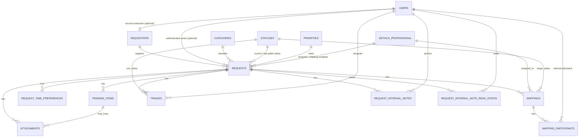

# Persistência das Solicitações

## Issues relacionadas

- Issue #23 — BANCO DE DADOS - Modelar persistência das solicitações
- Issue #53 — vínculo opcional da solicitação com `users`
- Issue #130 — revisão do banco de dados e melhorias

## Objetivo

Documentar a estrutura de banco de dados do fluxo de solicitações do NEO:
solicitante, tabelas de referência, solicitação, pendências, anexos,
preferências de horário, mapeamentos, triagens e observações internas, com seus
relacionamentos, restrições, índices e decisões de modelagem.

O inventário completo e os achados da revisão estão em
[`schema-review-130.md`](schema-review-130.md). A fonte de verdade do schema é o
diretório `migrations/`.

## Visão geral do modelo

O domínio de solicitações é composto por estas tabelas:

- `requesters`: dados do solicitante do pedido;
- `categories`: categorias da demanda (referência);
- `statuses`: matriz de status (referência; 17 status canônicos desde o motor v4);
- `priorities`: faixas de priorização (referência);
- `details_professional`: responsáveis técnicos (1:1 com `users`);
- `requests`: a solicitação e seus blocos de formulário e fluxo;
- `pending_items`: pendências por campo abertas por analistas;
- `attachments`: anexos do pedido e, opcionalmente, de uma pendência;
- `request_time_preferences`: até três horários de preferência para mapeamento;
- `mappings`: esforços de mapeamento de uma solicitação;
- `mapping_participants`: participantes internos ou externos de um mapeamento;
- `triages`: histórico versionado de triagens;
- `request_internal_notes`: observações internas imutáveis;
- `request_internal_note_read_states`: checkpoint de leitura por usuário.

Tabelas fora deste domínio: `profiles`, `users`, `audit_history`,
`prioritization_evaluations`, `criteria`, `system_themes` e `system_settings`.

### Diagrama de relacionamento



`PK` = Primary Key; `FK` = Foreign Key; `UK` = Unique Key.

## Tabela `requesters`

Armazena os dados do solicitante informados no bloco `requester` do formulário.
Opcionalmente estende uma conta de `users` (1:1).

| Campo                | Tipo         | Obrigatório | Restrição / Default                                             | Finalidade                           |
| -------------------- | ------------ | ----------- | --------------------------------------------------------------- | ------------------------------------ |
| `requester_id`       | UUID         | Sim         | PK, `gen_random_uuid()`                                         | Identificador interno do solicitante |
| `full_name`          | VARCHAR(150) | Sim         | NOT NULL                                                        | Nome completo — limite 150           |
| `corporate_email`    | VARCHAR(254) | Sim         | NOT NULL; UK `uk_requesters_email`, UK `uk_requesters_email_ci` | E-mail corporativo — limite 254      |
| `area`               | VARCHAR(100) | Não         | NULL permitido; indexado                                        | Área do solicitante — limite 100     |
| `department`         | VARCHAR(100) | Não         | NULL permitido                                                  | Departamento — limite 100            |
| `manager_name`       | VARCHAR(150) | Não         | NULL permitido                                                  | Gestor responsável — limite 150      |
| `additional_contact` | VARCHAR(100) | Não         | NULL permitido                                                  | Contato adicional — limite 100       |
| `user_id`            | INTEGER      | Não         | FK `users.user_id` (SET NULL); UK `uk_requesters_user`          | Conta correspondente (1:1)           |
| `created_at`         | TIMESTAMPTZ  | Sim         | DEFAULT `CURRENT_TIMESTAMP`                                     | Data e hora de criação               |

- `area` e `manager_name` passaram a ser nuláveis na migration
  `20260921000000_add_requesters_user_id.js` (extensão criada antes da primeira
  solicitação autenticada); o `POST /requests` continua exigindo ambos no
  payload.
- `corporate_email` tem unicidade case-insensitive (`uk_requesters_email_ci`,
  sobre `lower(corporate_email)`); a aplicação normaliza para lowercase antes
  de gravar/consultar.

## Tabela `categories`

Tabela de referência administrável pelo módulo de configurações.

| Campo           | Tipo        | Obrigatório | Restrição / Default                                                 | Finalidade                 |
| --------------- | ----------- | ----------- | ------------------------------------------------------------------- | -------------------------- |
| `category_id`   | INTEGER     | Sim         | PK, auto increment                                                  | Identificador da categoria |
| `name`          | VARCHAR(80) | Sim         | UK `uk_categories_name`; UK `uk_categories_name_ci` (`lower(name)`) | Nome — limite 80           |
| `description`   | TEXT        | Não         | NULL permitido                                                      | Descrição                  |
| `status`        | ENUM        | Sim         | `active`/`inactive`; DEFAULT `active`                               | Situação do cadastro       |
| `display_order` | INTEGER     | Não         | NULL permitido                                                      | Ordem de exibição          |
| `created_at`    | TIMESTAMPTZ | Sim         | DEFAULT `CURRENT_TIMESTAMP`                                         | Data e hora de criação     |

- `uk_categories_name_ci` reforça no banco a unicidade case-insensitive.
- índice em `status` (`idx_categories_status`).

## Tabela `statuses`

Matriz de status do fluxo, evoluída para o motor v4
(`20260924000000_add_status_engine_v4_columns.js` +
`20260926000000_complete_status_transition_v4.js`). O conjunto canônico final é
o dos 17 status de referência (IDs 1–17).

| Campo           | Tipo         | Obrigatório | Restrição / Default                   | Finalidade                           |
| --------------- | ------------ | ----------- | ------------------------------------- | ------------------------------------ |
| `status_id`     | INTEGER      | Sim         | PK, auto increment                    | Identificador                        |
| `order_number`  | INTEGER      | Sim         | UK `uk_statuses_order` (DEFERRABLE)   | Ordem de exibição                    |
| `name`          | VARCHAR(100) | Sim         | UK `uk_statuses_name`                 | Nome                                 |
| `description`   | TEXT         | Não         | NULL permitido                        | Descrição                            |
| `tone`          | ENUM         | Sim         | `status_tone`; DEFAULT `info`         | Tom visual                           |
| `is_active`     | BOOLEAN      | Sim         | DEFAULT FALSE                         | Status disponível para uso           |
| `is_core`       | BOOLEAN      | Sim         | DEFAULT FALSE                         | Status central do fluxo              |
| `is_restricted` | BOOLEAN      | Sim         | DEFAULT FALSE                         | Exige administrador para transição   |
| `is_terminal`   | BOOLEAN      | Sim         | DEFAULT FALSE                         | Encerra a solicitação                |
| `triage_mode`   | ENUM         | Sim         | `status_triage_mode`; DEFAULT `none`  | Como o status se relaciona à triagem |
| `mapping_mode`  | ENUM         | Sim         | `status_mapping_mode`; DEFAULT `none` | Como se relaciona ao mapeamento      |
| `is_public`     | BOOLEAN      | Sim         | DEFAULT FALSE                         | Visível ao solicitante               |

- `order_number` é único e `DEFERRABLE INITIALLY DEFERRED` para permitir a
  renumeração atômica do `PATCH /portal-config/statuses`.
- O enum `status_tone` usa `error | success | info | warning | neutral`;
  `status_triage_mode`/`status_mapping_mode` usam
  `none | free | conclusion_only`.
- As colunas legadas `is_final`, `is_triage_exit`, `closes_request` e
  `visibility` foram removidas pelo motor v4.

## Tabela `priorities`

Faixas de priorização e peso usado no cálculo do score (RN-007/RN-008).

| Campo            | Tipo         | Obrigatório | Restrição / Default         | Finalidade                          |
| ---------------- | ------------ | ----------- | --------------------------- | ----------------------------------- |
| `priority_id`    | INTEGER      | Sim         | PK, auto increment          | Identificador da faixa              |
| `level`          | VARCHAR(50)  | Sim         | UK `uk_priorities_level`    | `Baixa`, `Média`, `Alta`, `Crítica` |
| `min_score`      | DECIMAL(4,1) | Sim         | CHECK 10..50                | Limite inferior                     |
| `max_score`      | DECIMAL(4,1) | Sim         | CHECK 10..50; `min <= max`  | Limite superior                     |
| `default_weight` | DECIMAL(3,2) | Sim         | NOT NULL                    | Peso padrão                         |
| `color_code`     | VARCHAR(50)  | Não         | NULL permitido              | Cor associada                       |
| `description`    | TEXT         | Não         | NULL permitido              | Descrição                           |
| `created_at`     | TIMESTAMPTZ  | Sim         | DEFAULT `CURRENT_TIMESTAMP` | Data e hora de criação              |

## Tabela `details_professional`

Responsáveis técnicos atribuíveis (1:1 com `users`). Criada como
`professionals` e renomeada pela migration
`20260917013250_rename_professionals_to_details_professional.js`; nome e e-mail
vêm de `users`, nunca desta tabela.

| Campo                   | Tipo         | Obrigatório | Restrição / Default                         | Finalidade                    |
| ----------------------- | ------------ | ----------- | ------------------------------------------- | ----------------------------- |
| `professional_id`       | UUID         | Sim         | PK, `gen_random_uuid()`                     | Identificador do responsável  |
| `user_id`               | INTEGER      | Sim         | NOT NULL; UK; FK `users.user_id` (RESTRICT) | Usuário correspondente        |
| `job_title`             | VARCHAR(100) | Não         | NULL permitido                              | Cargo/função                  |
| `specialties`           | TEXT         | Não         | NULL permitido                              | Especialidades                |
| `attended_category_ids` | TEXT         | Não         | NULL permitido                              | Categorias atendidas          |
| `status`                | ENUM         | Sim         | `active`/`inactive`; DEFAULT `active`       | Está na rotação de atribuição |
| `capacity`              | INTEGER      | Sim         | DEFAULT 5                                   | Capacidade de atendimento     |
| `notes`                 | TEXT         | Não         | NULL permitido                              | Observações internas          |

Elegibilidade para atribuição: `status = 'active'` **e** `users.is_active`
**e** perfil `analista`/`gestor` (ver
`docs/requests-assignment-contract.md`).

## Tabela `requests`

Cada linha é uma solicitação, identificada pelo protocolo público e pelo
`request_id` interno sequencial.

### Identificação e blocos do formulário

| Campo                          | Tipo          | Obrigatório | Restrição / Default                   | Finalidade                      |
| ------------------------------ | ------------- | ----------- | ------------------------------------- | ------------------------------- |
| `request_id`                   | BIGINT        | Sim         | PK, `nextval('requests_request_seq')` | Identificador interno           |
| `protocol`                     | VARCHAR(25)   | Sim         | UK `uk_requests_protocol`             | Protocolo público FPE/Feistel   |
| `requester_id`                 | UUID          | Sim         | FK `requesters` (RESTRICT)            | Solicitante                     |
| `title`                        | VARCHAR(150)  | Sim         | NOT NULL                              | Título                          |
| `request_type`                 | VARCHAR(80)   | Sim         | NOT NULL                              | Tipo de solicitação             |
| `process_name`                 | VARCHAR(150)  | Sim         | NOT NULL                              | Nome do processo                |
| `need_description`             | VARCHAR(4000) | Sim         | NOT NULL                              | Descrição da necessidade        |
| `problem_opportunity`          | VARCHAR(4000) | Sim         | NOT NULL                              | Problema/oportunidade           |
| `expected_result`              | VARCHAR(4000) | Sim         | NOT NULL                              | Resultado esperado              |
| `justification`                | VARCHAR(4000) | Sim         | NOT NULL                              | Justificativa                   |
| `process_description`          | VARCHAR(4000) | Sim         | NOT NULL                              | Descrição do processo atual     |
| `process_steps`                | VARCHAR(4000) | Sim         | NOT NULL                              | Etapas do processo              |
| `systems_used`                 | VARCHAR(255)  | Sim         | NOT NULL                              | Sistemas utilizados             |
| `execution_frequency`          | VARCHAR(50)   | Sim         | NOT NULL                              | Frequência                      |
| `approximate_volume`           | VARCHAR(100)  | Sim         | NOT NULL                              | Volumetria                      |
| `people_involved`              | INTEGER       | Sim         | CHECK `> 0`                           | Pessoas envolvidas              |
| `average_duration`             | VARCHAR(60)   | Sim         | NOT NULL                              | Tempo médio                     |
| `estimated_monthly_effort`     | DECIMAL(10,2) | Sim         | CHECK `>= 0`                          | Esforço mensal em horas         |
| `has_manual_controls`          | BOOLEAN       | Sim         | NOT NULL                              | Existem controles manuais       |
| `manual_controls_detail`       | VARCHAR(1000) | Não         | NULL permitido                        | Detalhe dos controles           |
| `main_risks`                   | VARCHAR(2000) | Sim         | NOT NULL                              | Riscos                          |
| `client_impact`                | VARCHAR(2000) | Sim         | NOT NULL                              | Impacto no cliente              |
| `operational_impact`           | ENUM          | Sim         | `Baixo`/`Médio`/`Alto`/`Crítico`      | Impacto operacional             |
| `desired_deadline`             | DATE          | Sim         | NOT NULL                              | Prazo desejado                  |
| `perceived_criticality`        | ENUM          | Sim         | `Baixa`/`Média`/`Alta`/`Crítica`      | Criticidade percebida           |
| `has_process_documentation`    | BOOLEAN       | Não         | NULL permitido                        | Existe documentação do processo |
| `process_documentation_detail` | VARCHAR(1000) | Não         | NULL permitido                        | Detalhe                         |
| `has_similar_solution`         | BOOLEAN       | Não         | NULL permitido                        | Existe solução semelhante       |
| `similar_solution_detail`      | VARCHAR(1000) | Não         | NULL permitido                        | Detalhe                         |
| `depends_on_other_areas`       | BOOLEAN       | Não         | NULL permitido                        | Depende de outras áreas         |
| `other_areas_detail`           | VARCHAR(1000) | Não         | NULL permitido                        | Detalhe                         |
| `handles_restricted_info`      | BOOLEAN       | Não         | NULL permitido                        | Trata informações restritas     |
| `restricted_info_detail`       | VARCHAR(1000) | Não         | NULL permitido                        | Detalhe                         |
| `additional_notes`             | VARCHAR(2000) | Não         | NULL permitido                        | Observações adicionais          |

### Colunas de fluxo, triagem e acompanhamento

| Campo                     | Tipo         | Obrigatório | Restrição / Default                            | Finalidade                                         |
| ------------------------- | ------------ | ----------- | ---------------------------------------------- | -------------------------------------------------- |
| `category_id`             | INTEGER      | Sim         | FK `categories` (RESTRICT)                     | Categoria                                          |
| `status_id`               | INTEGER      | Sim         | FK `statuses` (RESTRICT)                       | Status atual                                       |
| `last_public_status_id`   | INTEGER      | Não         | FK `statuses` (RESTRICT); indexado             | Último status público (painel do solicitante)      |
| `priority_id`             | INTEGER      | Não         | FK `priorities` (RESTRICT)                     | Prioridade                                         |
| `professional_id`         | UUID         | Não         | FK `details_professional` (SET NULL)           | Responsável técnico                                |
| `mapping_professional_id` | UUID         | Não         | FK `details_professional` (SET NULL); indexado | Designado para executar o mapeamento               |
| `requester_user_id`       | INTEGER      | Não         | FK `users` (SET NULL); indexado                | Conta autenticada que criou (NULL no modo público) |
| `screening_result`        | VARCHAR(50)  | Não         | NULL permitido                                 | Resultado da triagem (em uso)                      |
| `internal_notes`          | TEXT         | Não         | NULL permitido                                 | Notas internas (campo texto legado, em uso)        |
| `next_steps`              | TEXT         | Não         | NULL permitido                                 | Próximos passos                                    |
| `last_technical_message`  | TEXT         | Não         | NULL permitido                                 | Última mensagem pública do responsável             |
| `estimated_completion`    | DATE         | Não         | NULL permitido                                 | Previsão de conclusão                              |
| `meeting_scheduled_for`   | TIMESTAMPTZ  | Não         | NULL permitido                                 | Data/hora da reunião de mapeamento                 |
| `meeting_link`            | TEXT         | Não         | NULL permitido                                 | Link da reunião                                    |
| `created_by`              | VARCHAR(254) | Sim         | NOT NULL                                       | Usuário/e-mail de criação                          |
| `created_at`              | TIMESTAMPTZ  | Sim         | DEFAULT `CURRENT_TIMESTAMP`                    | Criação                                            |
| `updated_by`              | VARCHAR(254) | Não         | NULL permitido                                 | Usuário/e-mail da última atualização               |
| `updated_at`              | TIMESTAMPTZ  | Não         | NULL permitido                                 | Última atualização                                 |
| `last_external_update_at` | TIMESTAMPTZ  | Não         | NULL permitido                                 | Última atualização visível ao solicitante          |

- Índices: `idx_requests_created_at`, `_status`, `_category`, `_priority`,
  `_professional`, `_requester`, `_requester_user`, `_mapping_professional`,
  `_last_public_status`.
- `people_involved > 0` (`ck_requests_people_involved`);
  `estimated_monthly_effort >= 0` (`ck_requests_estimated_monthly_effort`).

### Respostas "Sim/Não (+ detalhamento)"

Os campos derivados de `YesNoDetail` são persistidos como um par: uma flag
booleana e uma coluna de detalhe (`VARCHAR(1000)`). A string de detalhe só é
preenchida quando a resposta é afirmativa; a obrigatoriedade do detalhe é
responsabilidade da aplicação.

## Tabela `pending_items`

Pendências por campo abertas por analistas durante a triagem, no contrato
`requested → responded → validated` (ver `docs/contract-pendencias_03.md`).

| Campo                | Tipo         | Obrigatório | Restrição / Default                                      | Finalidade                        |
| -------------------- | ------------ | ----------- | -------------------------------------------------------- | --------------------------------- |
| `pending_item_id`    | UUID         | Sim         | PK, `gen_random_uuid()`                                  | Identificador                     |
| `request_id`         | BIGINT       | Sim         | FK `requests` (CASCADE)                                  | Solicitação                       |
| `batch_id`           | UUID         | Sim         | DEFAULT `gen_random_uuid()`; indexado                    | Agrupa pendências criadas juntas  |
| `type`               | ENUM         | Sim         | `field_edit`/`observation`                               | Tipo                              |
| `field_key`          | VARCHAR(100) | Não         | NULL permitido                                           | Chave do campo alvo               |
| `field_label`        | VARCHAR(255) | Não         | NULL permitido                                           | Rótulo do campo                   |
| `current_value`      | JSONB        | Não         | NULL permitido                                           | Valor atual do campo              |
| `comment`            | TEXT         | Sim         | NOT NULL                                                 | Observação da pendência           |
| `status`             | ENUM         | Sim         | `requested`/`responded`/`validated`; DEFAULT `requested` | Situação                          |
| `corrected_value`    | JSONB        | Não         | NULL permitido                                           | Valor corrigido pelo solicitante  |
| `response_text`      | TEXT         | Não         | NULL permitido                                           | Resposta textual                  |
| `responded_at`       | TIMESTAMPTZ  | Não         | NULL permitido                                           | Respondida em                     |
| `validated_at`       | TIMESTAMPTZ  | Não         | NULL permitido                                           | Validada em                       |
| `request_attachment` | BOOLEAN      | Sim         | DEFAULT FALSE                                            | Exige anexo do solicitante        |
| `deadline`           | DATE         | Não         | NULL permitido                                           | Prazo                             |
| `created_by`         | VARCHAR(100) | Sim         | NOT NULL                                                 | Usuário/e-mail de criação         |
| `created_at`         | TIMESTAMPTZ  | Sim         | DEFAULT `CURRENT_TIMESTAMP`                              | Criação                           |
| `description`        | TEXT         | Sim         | NOT NULL                                                 | **Legado** — espelho de `comment` |

- Índices: `idx_pending_items_request`, `_status`, `_request_status`, `_batch`.
- As colunas `requested_fields`, `requires_attachment`,
  `expected_attachment_type`, `resolution`, `resolved_by` e `resolved_at`
  foram removidas pela revisão do banco (substituídas pelo contrato 03).
- A coluna `is_visible_to_requester` foi removida (toda pendência é para o
  solicitante).

## Tabela `attachments`

Metadados dos anexos derivados no servidor.

| Campo             | Tipo          | Obrigatório | Restrição / Default           | Finalidade               |
| ----------------- | ------------- | ----------- | ----------------------------- | ------------------------ |
| `attachment_id`   | UUID          | Sim         | PK, `gen_random_uuid()`       | Identificador do anexo   |
| `request_id`      | BIGINT        | Sim         | FK `requests` (CASCADE)       | Solicitação associada    |
| `pending_item_id` | UUID          | Não         | FK `pending_items` (SET NULL) | Pendência associada      |
| `file_name`       | VARCHAR(255)  | Sim         | NOT NULL                      | Nome original            |
| `file_path`       | VARCHAR(1000) | Sim         | NOT NULL                      | Caminho de armazenamento |
| `content_type`    | VARCHAR(100)  | Sim         | CHECK de formato              | MIME do anexo            |
| `size_bytes`      | BIGINT        | Sim         | CHECK 1..10MB                 | Tamanho em bytes         |
| `uploaded_by`     | VARCHAR(254)  | Não         | NULL permitido                | Usuário/e-mail do envio  |
| `uploaded_at`     | TIMESTAMPTZ   | Sim         | DEFAULT `CURRENT_TIMESTAMP`   | Data e hora do envio     |

- `content_type` restrito a PDF, DOCX, XLSX, PNG e JPG
  (`ck_attachments_content_type`).
- Índices: `idx_attachments_request`, `_pending_item`, `_uploaded_at`. A coluna
  `is_restricted` e seu índice ocioso foram removidos pela revisão do banco.

## Tabela `request_time_preferences`

Até três opções de data/hora declaradas pelo solicitante para o mapeamento.

| Campo                        | Tipo        | Obrigatório | Restrição / Default         | Finalidade                 |
| ---------------------------- | ----------- | ----------- | --------------------------- | -------------------------- |
| `request_time_preference_id` | INTEGER     | Sim         | PK, auto increment          | Identificador              |
| `request_id`                 | BIGINT      | Sim         | FK `requests` (CASCADE)     | Solicitação associada      |
| `scheduled_for`              | TIMESTAMP   | Sim         | NOT NULL                    | Data e hora (sem timezone) |
| `created_at`                 | TIMESTAMPTZ | Sim         | DEFAULT `CURRENT_TIMESTAMP` | Criação                    |

- `(request_id, scheduled_for)` é único (`uk_request_time_preferences_slot`).
- `scheduled_for` é `timestamp` sem timezone por decisão explícita do helper
  (`src/shared/utils/date.ts`); a troca para `timestamptz` exige mudança
  coordenada no código.
- O limite de três opções é validado pela aplicação.

## Tabela `mappings`

Esforços de mapeamento de uma solicitação (1:N). No máximo um esforço aberto por
solicitação.

| Campo                    | Tipo          | Obrigatório | Restrição / Default                            | Finalidade                     |
| ------------------------ | ------------- | ----------- | ---------------------------------------------- | ------------------------------ |
| `mapping_id`             | UUID          | Sim         | PK, `gen_random_uuid()`                        | Identificador exposto na API   |
| `request_id`             | BIGINT        | Sim         | FK `requests` (CASCADE)                        | Solicitação                    |
| `professional_id`        | UUID          | Não         | FK `details_professional` (SET NULL); indexado | Designado a executar           |
| `scheduled_for`          | TIMESTAMPTZ   | Não         | NULL permitido                                 | Data/hora agendada             |
| `duration_minutes`       | INTEGER       | Não         | CHECK 15..480                                  | Duração                        |
| `modality`               | ENUM          | Não         | `mapping_modality` (`REMOTE`/`IN_PERSON`)      | Modalidade                     |
| `meeting_link`           | VARCHAR(500)  | Não         | NULL permitido                                 | Link                           |
| `location`               | VARCHAR(500)  | Não         | NULL permitido                                 | Local                          |
| `notes`                  | VARCHAR(2000) | Não         | NULL permitido                                 | Observações                    |
| `is_concluded`           | BOOLEAN       | Sim         | DEFAULT FALSE                                  | Esforço concluído              |
| `concluded_at`           | TIMESTAMPTZ   | Não         | NULL permitido                                 | Concluído em                   |
| `target_status_id`       | INTEGER       | Não         | FK `statuses` (RESTRICT); indexado             | Status de destino na conclusão |
| `justification`          | TEXT          | Não         | NULL permitido                                 | Justificativa da conclusão     |
| `last_technical_message` | TEXT          | Não         | NULL permitido                                 | Última mensagem pública        |
| `created_by`             | VARCHAR(100)  | Sim         | NOT NULL                                       | Criado por                     |
| `created_at`             | TIMESTAMPTZ   | Sim         | DEFAULT `CURRENT_TIMESTAMP`                    | Criação                        |
| `updated_by`             | VARCHAR(100)  | Não         | NULL permitido                                 | Atualizado por                 |
| `updated_at`             | TIMESTAMPTZ   | Não         | NULL permitido                                 | Última atualização             |

- `duration_minutes` usa `ck_mappings_duration_minutes` (15 a 480).
- Índices: `idx_mappings_request`, `_request_concluded`, `_professional`,
  `_target_status`.
- **Invariante:** `uk_mappings_one_open_per_request` — índice único parcial em
  `request_id` `WHERE is_concluded = false`.
- **CHECK** `ck_mappings_concluded_at`: `concluded_at` é preenchido se e somente
  se `is_concluded` for `true`.

## Tabela `mapping_participants`

Participantes de um mapeamento: internos (vinculados a `users.user_id`) ou
externos (nome/e-mail informados no payload).

| Campo            | Tipo         | Obrigatório | Restrição / Default             | Finalidade                          |
| ---------------- | ------------ | ----------- | ------------------------------- | ----------------------------------- |
| `participant_id` | UUID         | Sim         | PK, `gen_random_uuid()`         | Identificador                       |
| `mapping_id`     | UUID         | Sim         | FK `mappings` (CASCADE)         | Mapeamento                          |
| `user_id`        | INTEGER      | Não         | FK `users` (SET NULL); indexado | Participante interno                |
| `name`           | VARCHAR(255) | Não         | NULL permitido                  | Nome (interno herdado ou externo)   |
| `email`          | VARCHAR(255) | Não         | NULL permitido                  | E-mail (interno herdado ou externo) |
| `created_at`     | TIMESTAMPTZ  | Sim         | DEFAULT `CURRENT_TIMESTAMP`     | Criação                             |

- `uk_mapping_participants_user` → único (`mapping_id`, `user_id`).
- `uk_mapping_participants_email` → único (`mapping_id`, `lower(email)`).
- `idx_mapping_participants_mapping`, `idx_mapping_participants_user`.
- **CHECK** `ck_mapping_participants_internal_or_external`:
  `user_id IS NOT NULL OR (name IS NOT NULL AND email IS NOT NULL)`.

## Tabela `triages`

Histórico versionado de triagens (append). O snapshot fica normalizado em
colunas; a proveniência (`occurred_at`/ator/origem) vem do `audit_history`
(`entity_type = 'request'`, `action_type = 'request.triage'`).

| Campo                                 | Tipo          | Obrigatório | Restrição / Default                | Finalidade                      |
| ------------------------------------- | ------------- | ----------- | ---------------------------------- | ------------------------------- |
| `triage_id`                           | UUID          | Sim         | PK (fornecido pela aplicação)      | Identificador                   |
| `request_id`                          | BIGINT        | Sim         | FK `requests` (CASCADE)            | Solicitação                     |
| `adherent_to_scope`                   | VARCHAR(3)    | Sim         | CHECK `Sim`/`Não`/`''`             | Aderente ao escopo              |
| `adherent_justification`              | TEXT          | Sim         | DEFAULT `''`                       | Justificativa                   |
| `change_category`                     | VARCHAR(3)    | Sim         | CHECK `Sim`/`Não`/`''`             | Muda de categoria               |
| `new_category`                        | VARCHAR(40)   | Sim         | DEFAULT `''`                       | Nova categoria                  |
| `preliminary_complexity`              | TEXT          | Sim         | DEFAULT `''`                       | Complexidade preliminar         |
| `perceived_risks`                     | TEXT          | Sim         | DEFAULT `''`                       | Riscos percebidos               |
| `suggested_responsible`               | VARCHAR(150)  | Sim         | DEFAULT `''`                       | Responsável sugerido            |
| `suggested_responsible_justification` | TEXT          | Sim         | DEFAULT `''`                       | Justificativa do responsável    |
| `exit_status`                         | INTEGER       | Sim         | FK `statuses` (RESTRICT); indexado | Status de saída                 |
| `result`                              | VARCHAR(1000) | Sim         | NOT NULL                           | Resultado                       |
| `conclusion_justification`            | TEXT          | Sim         | NOT NULL                           | Justificativa da conclusão      |
| `assignee_user_id`                    | INTEGER       | Não         | FK `users` (SET NULL); indexado    | Designado (v4)                  |
| `assignee_name`                       | TEXT          | Não         | NULL permitido                     | Snapshot do nome do designado   |
| `assignee_email`                      | TEXT          | Não         | NULL permitido                     | Snapshot do e-mail do designado |
| `last_technical_message`              | TEXT          | Não         | NULL permitido                     | Última mensagem pública         |

- Índices: `idx_triages_request_triage` (`request_id`, `triage_id`),
  `_exit_status`, `_assignee_user`.

## Tabelas de observações internas

### `request_internal_notes`

Observações internas imutáveis, uma linha por nota.

| Campo                     | Tipo        | Obrigatório | Restrição / Default                       | Finalidade                   |
| ------------------------- | ----------- | ----------- | ----------------------------------------- | ---------------------------- |
| `internal_note_id`        | BIGSERIAL   | Sim         | PK                                        | Identificador                |
| `request_id`              | BIGINT      | Sim         | FK `requests` (RESTRICT)                  | Solicitação                  |
| `author_user_id`          | INTEGER     | Sim         | FK `users` (RESTRICT); indexado           | Autor                        |
| `author_role_at_creation` | VARCHAR(30) | Sim         | CHECK `Analista`/`Gestor`/`Administrador` | Perfil no momento da criação |
| `content`                 | TEXT        | Sim         | CHECK 1..4000 (após `btrim`)              | Conteúdo                     |
| `created_at`              | TIMESTAMPTZ | Sim         | DEFAULT `CURRENT_TIMESTAMP`               | Criação                      |

- UK `uk_request_internal_notes_request_note` (`request_id`,
  `internal_note_id`) — alvo da FK composta do checkpoint.
- `idx_request_internal_notes_timeline` (`request_id`, `created_at`,
  `internal_note_id`) e `idx_request_internal_notes_author`.

### `request_internal_note_read_states`

Checkpoint de leitura por usuário (uma linha por solicitação/usuário).

| Campo               | Tipo        | Obrigatório | Restrição / Default                          | Finalidade         |
| ------------------- | ----------- | ----------- | -------------------------------------------- | ------------------ |
| `request_id`        | BIGINT      | Sim         | PK composta; FK composta → notes             | Solicitação        |
| `user_id`           | INTEGER     | Sim         | PK composta; FK `users` (RESTRICT); indexado | Usuário            |
| `last_read_note_id` | BIGINT      | Sim         | FK composta → notes; indexado                | Última nota lida   |
| `read_at`           | TIMESTAMPTZ | Sim         | DEFAULT `CURRENT_TIMESTAMP`                  | Momento da leitura |

- PK `pk_request_internal_note_read_states` (`request_id`, `user_id`).
- FK `fk_internal_note_read_states_request_note` (`request_id`,
  `last_read_note_id`) → `request_internal_notes` (RESTRICT).

## Protocolo

O identificador público de rastreio é o **protocolo** (`protocol VARCHAR(25)`,
`UNIQUE`, `NOT NULL`). Ele é **não enumerável** e derivado do `request_id`
interno por FPE/Feistel (ex.: `MAAT-8K3P-9X2M`), conforme o contrato
(`docs/solicitations-api-requests-0_4.md`).

- `request_id` é gerado pela sequence `requests_request_seq`;
- a aplicação pré-aloca o `request_id` com `nextval`, calcula o código FPE e o
  grava no mesmo `INSERT`;
- a constraint `UNIQUE` do protocolo atua como rede de segurança contra
  colisões;
- buracos na sequence são aceitáveis (o `request_id` é interno).

## Decisões de modelagem

- **Solicitante em tabela própria:** `requesters` evita repetir dados do
  solicitante e permite acompanhamento por e-mail; `corporate_email` é único
  (case-sensitive; a aplicação normaliza).
- **Vínculo com a conta autenticada:** `requests.requester_user_id` (anulável,
  `ON DELETE SET NULL`) referencia a conta; o snapshot público continua em
  `requesters`. A coincidência de e-mail entre conta e snapshot é invariante da
  aplicação, não do banco.
- **`created_by` com o e-mail do solicitante:** no `POST /requests` público não
  há usuário autenticado; a coluna guarda o e-mail normalizado (por isso 254).
- **Categorias, status e prioridades como referência:** normalizam os domínios e
  viabilizam o CRUD de configurações.
- **`request_id` sequencial + protocolo FPE:** proteção contra varredura
  sequencial (IDOR).
- **Obrigatoriedade e limites espelhados no banco:** campos obrigatórios são
  `NOT NULL` e limites viram `VARCHAR`.
- **`YesNoDetail` como flag + detalhe:** uma flag booleana e uma coluna de
  detalhe.
- **Preferências de horário em tabela filha:** cada horário é uma linha, com
  `ON DELETE CASCADE`.
- **Prioridade nula até a triagem:** `priority_id` é nullable.
- **Triagem versionada:** `triages` guarda o snapshot imutável; o estado atual
  não é sobrescrito.
- **Mapeamento com histórico:** `mappings` é 1:N por solicitação, com no máximo
  um aberto (índice único parcial).
- **Participantes internos/externos:** `mapping_participants.user_id` é
  opcional; externos exigem nome e e-mail (CHECK).
- **Observações internas imutáveis:** `request_internal_notes` não é editada;
  correções viram novas notas. O checkpoint de leitura é por usuário.
- **Auditoria append-only:** `audit_history` tem trigger que impede UPDATE/DELETE
  (`20260923000001_add_audit_history_append_only_guard.js`).
- **Ambiente:** PostgreSQL 18 em Docker (`postgres:18-alpine`).

## Migrations

A estrutura é controlada por migrations do Knex, em três diretórios:
`migrations/` (autenticação, configuração e auditoria),
`migrations/requester_request/` (domínio de solicitações) e
`migrations/users/`. O `knexfile.js` carrega os três e ordena por timestamp.

Marcos relevantes do domínio:

1. `202609100001`–`202609100014`: modelagem inicial (requesters, referências,
   requests, pendências, anexos e preferências).
2. `20260916120000`: vínculo opcional `requests.requester_user_id` (issue #53).
3. `20260917013250`: rename `professionals` → `details_professional`.
4. `20260918000000`: `mappings` e `mapping_participants`.
5. `20260921000000`: `requesters.user_id` (1:1 com `users`).
6. `20260921000002`: contrato de pendências 03 (`batch_id`, `comment`, ciclo
   `requested/responded/validated`).
7. `20260922000000`: remove `is_visible_to_requester`.
8. `20260923000000`: `triages`.
9. `20260924000000` + `20260926000000`: motor de status v4 (status 1–17).
10. `20260927000000`: revisão do banco (índices de FK, invariantes de mapeamento
    e `audit_history.occurred_at` como `timestamptz`).
11. `20260928000000`: limpeza de legados, unicidade case-insensitive de e-mails,
    CHECK de conclusão de mapeamento e índice de timeline de auditoria.

### Execução

```bash
npm run migrate:latest
npm run migrate:rollback
npm run migrate:make -- migration-name
```

## Validações

- `npm run migrate:latest` em banco novo — 57 migrations;
- `npm run seed:run` — 11 seeds;
- `npm run migrate:rollback` / reaplicação das migrations da revisão;
- `npm run check` (typecheck + lint + Prettier).

O detalhamento dos achados e das melhorias da revisão está em
[`schema-review-130.md`](schema-review-130.md).
