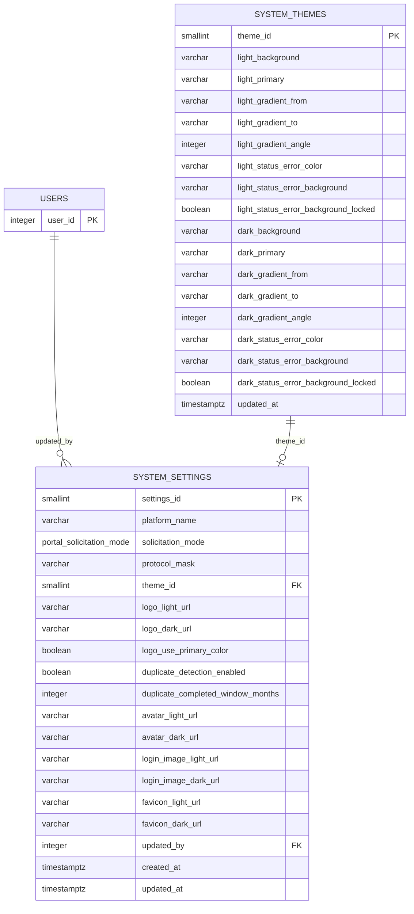

# Persistência da Configuração Global (`system_settings` + `system_themes`)

> ### ⚠️ Aviso de revisão (obrigatório na PR)
>
> Esta PR **REESCREVE a migration `20260915000000_create_system_settings.js`**
> que já está mergeada na `main` (PR #79). Ela foi remodelada para espelhar o
> regras em `docs/rules/portal-config.md` (Aparência em `system_themes` + identity/access/
> assets no `system_settings`). **O banco deve ser recriado do zero**
> (`DROP DATABASE` + `CREATE DATABASE` + `migrate:latest` + `seed:run`).
> **NÃO executar `migrate:latest` em ambientes que já tenham a #79 aplicada**
> — o Knex pula migration com batch registrado e o schema ficaria com as
> colunas antigas (`allowed_colors`/`access_mode`).

## Issues relacionadas

- Issue #54 — BACKEND - Persistência de configuração global do portal
- Issue #90 (regras em `docs/rules/portal-config.md`) — Configuração do portal (PortalConfig)

## Objetivo

Documentar a estrutura de banco de dados que persiste a configuração global do
portal — espelhando **exatamente** as regras de `docs/rules/portal-config.md` naquilo que
**não** vive em tabelas próprias.

O contrato é dividido em **duas tabelas**:

1. **`system_themes`** — TABELA PRÓPRIA da Aparência (`light`/`dark`), com **colunas
   explícitas** por token, gradiente e statuses — **sem JSONB** para as cores.
2. **`system_settings`** — o **resto** do singleton: identity (`platform_name`,
   `protocol_mask`), access (`solicitation_mode`) e assets (4 URLs), com FK para
   a Aparência vigente.

Ambas são singletons (`= 1`), garantidos por PK + CHECK.

## Visão geral do modelo

### O que NÃO fica no `system_settings`

Os dados que já vivem em tabelas próprias ficam nas suas tabelas, conforme o
contrato:

| Seção do contrato       | Tabela existente                               |
| ----------------------- | ---------------------------------------------- |
| `categories`            | `categories`                                   |
| `statuses`              | `statuses`                                     |
| `prioritizationWeights` | `criteria` (pesos por critério)                |
| `theme`                 | `system_themes` (tabela própria desta entrega) |

### Diagrama de relacionamento



Onde: `PK` = Primary Key; `FK` = Foreign Key.

## Tabela `system_settings`

Possui exatamente uma linha (singleton via `PRIMARY KEY` + `CHECK
(settings_id = 1)`). Mantém apenas o que não vive em tabela própria.

### Estrutura

| Campo                               | Tipo                            | Obrigatório | Restrição / Default                        | Finalidade                                                                          |
| ----------------------------------- | ------------------------------- | ----------- | ------------------------------------------ | ----------------------------------------------------------------------------------- |
| `settings_id`                       | SMALLINT                        | Sim         | PK; `DEFAULT 1`; CHECK `= 1`               | Chave do singleton                                                                  |
| `platform_name`                     | VARCHAR(80)                     | Sim         | Default `'MAAT'`                           | Nome exibido da plataforma                                                          |
| `solicitation_mode`                 | ENUM `portal_solicitation_mode` | Sim         | `PUBLIC`/`AUTHENTICATED`; default `PUBLIC` | Modo de abertura do portal (efetivo nas rotas de solicitação — `requireAccessMode`) |
| `protocol_mask`                     | VARCHAR(10)                     | Sim         | Default `'MAAT'`                           | Máscara dos protocolos                                                              |
| `theme_id`                          | SMALLINT                        | Não         | FK → `system_themes`, NULL permitido       | Aparência vigente (tabela própria)                                                  |
| `logo_light_url`                    | VARCHAR(500)                    | Não         | NULL permitido                             | URL/caminho do logo (Aparência clara)                                               |
| `logo_dark_url`                     | VARCHAR(500)                    | Não         | NULL permitido                             | URL/caminho do logo (Aparência escura)                                              |
| `logo_use_primary_color`            | BOOLEAN                         | Sim         | Default `false`                            | Logo renderizado monocromático na cor primária                                      |
| `duplicate_detection_enabled`       | BOOLEAN                         | Sim         | Default `false`                            | Liga/desliga a detecção de duplicidade (RF16 — issue #209)                          |
| `duplicate_completed_window_months` | INTEGER                         | Sim         | Default `3`; CHECK 1..36                   | Janela das concluídas no corpus (RF16 — issue #210)                                 |
| `avatar_light_url`                  | VARCHAR(500)                    | Não         | NULL permitido                             | URL/caminho do avatar (Aparência clara)                                             |
| `avatar_dark_url`                   | VARCHAR(500)                    | Não         | NULL permitido                             | URL/caminho do avatar (Aparência escura)                                            |
| `login_image_light_url`             | VARCHAR(500)                    | Não         | NULL permitido                             | URL/caminho da imagem de login (claro)                                              |
| `login_image_dark_url`              | VARCHAR(500)                    | Não         | NULL permitido                             | URL/caminho da imagem de login (escuro)                                             |
| `favicon_light_url`                 | VARCHAR(500)                    | Não         | NULL permitido                             | URL/caminho do favicon (Aparência clara)                                            |
| `favicon_dark_url`                  | VARCHAR(500)                    | Não         | NULL permitido                             | URL/caminho do favicon (Aparência escura)                                           |
| `updated_by`                        | INTEGER                         | Não         | FK → `users.user_id`, `ON DELETE SET NULL` | Usuário/admin que alterou                                                           |
| `created_at`                        | TIMESTAMPTZ                     | Sim         | DEFAULT `CURRENT_TIMESTAMP`                | Criação do registro                                                                 |
| `updated_at`                        | TIMESTAMPTZ                     | Não         | NULL até a primeira atualização            | Última atualização                                                                  |

## Tabela `system_themes`

Tabela **própria da Aparência**, colunas explícitas por paleta (sem JSONB), com
exatamente uma linha (singleton via `PRIMARY KEY` + `CHECK (theme_id = 1)`).

### Estrutura — theme (colunas explícitas)

Para cada paleta (`light_*` e `dark_*`) existem colunas explícitas:

- **Tokens de cor** — `VARCHAR(9)`, hex `#RRGGBB` ou `#RRGGBBAA` (NULL =
  Aparência indefinida):

  | Token           | Coluna                    |
  | --------------- | ------------------------- |
  | `background`    | `{paleta}_background`     |
  | `surface`       | `{paleta}_surface`        |
  | `border`        | `{paleta}_border`         |
  | `textPrimary`   | `{paleta}_text_primary`   |
  | `textSecondary` | `{paleta}_text_secondary` |
  | `heading`       | `{paleta}_heading`        |
  | `richBlack`     | `{paleta}_rich_black`     |
  | `primary`       | `{paleta}_primary`        |
  | `secondary`     | `{paleta}_secondary`      |
  | `tint`          | `{paleta}_tint`           |
  | `onPrimary`     | `{paleta}_on_primary`     |
  | `onDark`        | `{paleta}_on_dark`        |
  | `onGradient`    | `{paleta}_on_gradient`    |

- **Gradiente** — `VARCHAR(9)` em `from`/`to` (hex) e `INTEGER` em `angle`
  (default `143`, 0–360);

- **Statuses** — para cada um dos 5 tons (`error`, `success`, `info`,
  `warning`, `neutral`): `{paleta}_status_{tom}_color` (hex),
  `{paleta}_status_{tom}_background` (hex) e
  `{paleta}_status_{tom}_background_locked` (boolean);

- **Auditoria** — `updated_at` apenas (o criador da Aparência é o `updated_by`
  do `system_settings` quando se grava a Aparência).

### Restrições

- **Singleton:** `theme_id` é `PRIMARY KEY` + `CHECK (theme_id = 1)`;
- **Cores hex:** `ck_system_themes_theme_hex` — toda coluna de cor aceita
  `NULL` **ou** regex `^#([0-9A-Fa-f]{6}|[0-9A-Fa-f]{8})$` (`#RRGGBB` ou
  `#RRGGBBAA`);
- **Ângulo do gradiente:** `ck_system_themes_gradient_angle` — `NULL` ou
  0..360.

> Nota: o `?` é placeholder de binding no `knex.raw`; o regex usa alternância
> `|` para evitá-lo e não corromper a constraint criada via migration.

## Relação entre as tabelas

`system_settings.theme_id` → `system_themes.theme_id` (`ON DELETE SET NULL`).
A Aparência é a única seção da configuração com tabela própria nesta entrega;
`GET /portal-config` consolida settings + theme + (categories/statuses/criteria)
na camada de aplicação.

## Decisões de modelagem

### Por que `theme` em tabela separada e `system_settings` enxuto?

A Aparência tem estrutura larga e explícita (~66 colunas) e é atualizada de forma
**atômica** (`PATCH /portal-config/theme` substitui light+dark completos).
Isolá-lo em `system_themes`:

- mantém `system_settings` enxuto (identity/access/assets);
- dá espaço para evolução (ex.: histórico de versões da Aparência) sem tocar no
  singleton de configuração;
- mantém a validação de hex/ângulo no banco por CHECK.

### Por que colunas explícitas em vez de JSONB?

A Aparência tem estrutura **fixa** (tokens, gradiente, statuses), toda
hex validável. Colunas tipadas com CHECK de formato dão validação no banco,
refletem o schema no tipo `SystemThemeRow` e evitam o "config bag" do JSONB.

### Por que a Aparência pode iniciar vazia (cores NULL)?

O desenho permite "o backend iniciar sem Aparência e o frontend aplica os
defaults locais por token". O INSERT padrão cria o registro da Aparência
(theme_id = 1) sem
cores; `system_settings.theme_id` aponta para ele já no nascimento.

### Onde ficam categories, statuses e pesos?

Nas tabelas próprias (`categories`, `statuses`, `criteria`).

### O que a flag de duplicidade controla?

`duplicate_detection_enabled` (BOOLEAN, default `false`) é a chave geral do
Alerta de duplicidade do RF16 (issue #209). Desligada, ela limpa o índice
MiniSearch e faz `POST /requests/duplicates/check` responder vazio; o seed de
desenvolvimento liga a flag para demonstração. As allowlists de corpus vivem em
`categories.is_publicly_listable` e `statuses.is_duplicate_corpus_eligible`
(ver [`requests-persistence.md`](requests-persistence.md)).

`duplicate_completed_window_months` (INTEGER, default `3`, CHECK 1..36) define
por quantos meses uma Solicitação concluída continua no corpus (issue #210). A
leitura tem fallback 3 quando o singleton está ausente ou o valor é inválido,
com um aviso único por processo no log para não mascarar banco mal configurado.
A varredura da janela roda no poll e no rebuild, usa
`now() - make_interval(months => ?)` e reconcilia nos dois sentidos: suprime
fora da janela e republica `outside_window` que voltou para dentro dela,
reavaliando todas as regras. A edição administrativa da flag/janela é feita por
`PATCH /portal-config/duplicates` (issue #212): os dois campos são obrigatórios,
gravados na mesma transação com `FOR UPDATE` no singleton e registrados em
`audit_history` com as mesmas chaves antes/depois (`enabled` e
`completedWindowMonths`). Regras em
[`duplicate-detection.md`](../rules/duplicate-detection.md) e
[`portal-config.md`](../rules/portal-config.md).

## Aplicando e revertendo

```bash
# aplica (cria as duas tabelas, o enum e os registros padrão)
npm run migrate:latest

# reverte esta migration (remove as duas tabelas e o tipo nativo)
npx knex migrate:down --env development
```

Os registros padrão são inseridos **na própria migration** — os singletons
existem logo após o `migrate:latest`, sem depender de `seed:run`.

> **Atenção no rollback:** o `down` também remove o tipo nativo
> `portal_solicitation_mode` (`DROP TYPE IF EXISTS`). Seguro enquanto o tipo for
> exclusivo desta migration; se uma migration futura reutilizá-lo, o rollback
> precisará ser revisto.

## Exemplo de atualização (Aparência + parte visual)

```sql
-- Aparência (tabela própria)
UPDATE system_themes SET
  light_primary = '#00236F',
  dark_primary  = '#4C7DFF',
  light_gradient_from = '#002068',
  light_gradient_to   = '#003399',
  light_gradient_angle = 143,
  updated_at = now()
WHERE theme_id = 1;

-- resto do config (system_settings)
UPDATE system_settings SET
  logo_dark_url = '/assets/MAAT-logo-dark.svg',
  logo_use_primary_color = true,
  updated_by = 102,
  updated_at = now()
WHERE settings_id = 1;
```

## Fluxo dos PATCH (`/portal-config/*`)

Implementação: `src/modules/portalConfig/*` (issue #59). Cada `PATCH` por seção
opera em transação própria com lock do singleton:

- **`access` / `identity` / `assets`** → `UPDATE system_settings`
  (`solicitation_mode`, `platform_name`/`protocol_mask`, ou as 8 variantes de
  asset + `logo_use_primary_color`)
  - bloco `system_settings` com `FOR UPDATE`.
- **`theme`** → `themeToColumns(light/dark)` transforma o `PortalTheme` do
  contrato nas colunas planas de `system_themes` (~66 colunas) e faz `UPDATE`
  atômico, com `FOR UPDATE` também em `system_themes`; `themeFromRow` faz o
  caminho inverso no `GET` (aplica defaults do contrato quando a coluna é NULL).
  O mapeamento bidirecional vive em `portalConfig.mappers.ts`
  (`TOKEN_TO_COLUMN`/`statusColumns`).
- **`categories`** → upsert por `category_id` (aceita id novo gerado pelo
  cliente), `display_order` = índice do array; itens ausentes tornam-se
  `status = 'inactive'` (sem hard delete — FK RESTRICT em `requests`).
  `is_publicly_listable` é obrigatório no PATCH e grava a allowlist do corpus.
  Alterná-lo (ou omitir uma Categoria antes listável) reavalia, na mesma
  transação, as projeções das Solicitações da Categoria. Seguido de `setval`
  para não colidir com a sequence.
- **`statuses`** → upsert por `status_id`, `order_number` = índice e as flags
  do Motor v4 (`is_core`, `is_public`, `is_terminal`, `triage_mode`,
  `mapping_mode`, `is_restricted`, `tone`, `is_active`), além de
  `is_duplicate_corpus_eligible` (obrigatório no PATCH). Ausentes viram
  `is_active = false`, perdem a elegibilidade e são renumerados para depois dos
  enviados. Alternar a elegibilidade reavalia as projeções das Solicitações do
  Status na mesma transação. Status core
  (`1, 3, 4, 6, 7, 16, 17`) não podem ser removidos, renomeados, rebaixados,
  desativados nem ter flags/modos alterados — inclusive
  `is_duplicate_corpus_eligible` (violação → `409` com código estável
  `core_status_corpus_eligibility_locked`). A unicidade de `order_number`
  (`uk_statuses_order`) é `DEFERRABLE INITIALLY DEFERRED` (migration
  `20260919140000`), validada no commit após a renumeração. O `GET` retorna
  também os inativos (`isActive: false`), já que não há exclusão de status.
- **`prioritization-weights`** → mapeia as 10 chaves do contrato (EN) para
  `criteria.criterion_id` (pt snake) via `src/shared/types/criteria.ts`
  (`CRITERION_KEY_TO_ID`) e grava `criteria.weight` (inteiro 1–10 na API; o CHECK do banco aceita 0–10 para
  compatibilidade histórica).

Todos os PATCH registram auditoria (`audit_history`, entidade `settings`,
ação `settings.update`) na MESMA transação da alteração, com `FOR UPDATE` no
singleton para serializar escritas administrativas concorrentes.

> `solicitation_mode` é lido a cada request pelo guard `requireAccessMode()`
> (`src/shared/middleware/accessMode.ts`), então a alteração via `PATCH access`
> passa a valer imediatamente para `POST /requests`, `GET /requests` e
> `GET /requests/:protocol` — sem cache/restart. Comportamento por modo em
> [`docs/rules/public-tracking.md`](../rules/public-tracking.md).

### Assets binários (multipart)

`PATCH /portal-config/assets` é `multipart/form-data`: binários nomeados por
chave de variante (`logoLightUrl`, `logoDarkUrl`, `avatarLightUrl`,
`avatarDarkUrl`, `loginImageLightUrl`, `loginImageDarkUrl`, `faviconLightUrl`,
`faviconDarkUrl`) são gravados em `uploads/portal/` via `fileStorage.saveFiles`
e a URL relativa (`/uploads/portal/{variant}-{uuid}.{ext}`) persiste em
`system_settings`; chaves presentes no JSON `assets` definem a URL diretamente
e o flag `logoUsePrimaryColor` atualiza a coluna `logo_use_primary_color`.
Validação por chave (MIME/extensão/tamanho) em
`src/shared/middleware/uploadAssets.ts` (413/415). Em falha após gravar
binários, `removeFiles` limpa o disco.
